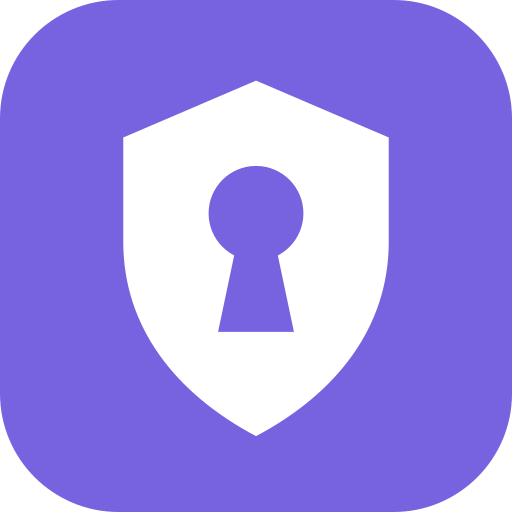

# Lockvyn — Windows 1.10 / Android 1.6



A native password manager for Windows x64 and Android 9+. Keep an encrypted vault on your device, with optional manual encrypted cloud sync and private Wi-Fi transfer. English interface; Unicode credentials, folders and notes. No advertising or analytics.

Lockvyn is the new product name for BoshaVault. Existing encrypted `.boshavault` files, pairing codes and cloud spaces remain compatible. Windows continues using the existing data directory. Source project names and authenticated encryption identifiers retain their original names to preserve compatibility.

**This update:** Android cloud fields accept the keyboard; **Options** stays accessible with large vaults; preset/custom encrypted folders filter independently from All/Favorites/Review/Trash; Trash supports confirmed permanent deletion; Review supports explicit acknowledgement; the password generator has configurable saved rules (initial length **24**, range **8–128**). The shield/keyhole icon appears on Windows, Android and the browser extension. Product versions and download names have no prerelease suffix. See [the vault guide](docs/VAULT-UX.md).

## Download and install

Open the successful **Build Lockvyn (Windows and Android)** run in [GitHub Actions](https://github.com/R3Dzf/BoshaVault/actions). Use the artifacts below; they expire after 14 days. Check [VALIDATION.md](docs/VALIDATION.md) for exactly what has passed.

| Artifact | Use |
|---|---|
| `Lockvyn-Windows-x64` | Extract the artifact ZIP, then the included `Lockvyn-Windows-x64.zip` into a permanent folder. Start `Lockvyn.exe` without administrator privileges. .NET is bundled. |
| `Lockvyn-Android` | Extract and install `Lockvyn-Android.apk`. Package `com.lockvyn.app` installs alongside older BoshaVault apps with separate storage. Import an encrypted backup or receive the existing Windows vault. |
| `Lockvyn-Android-LegacyPackage` | Advanced compatibility build using `com.bosha.vault`. An update requires the original signing certificate; ordinary CI uses a temporary certificate. |
| `Lockvyn-Android-UI-Logs` | Native emulator acceptance evidence, not an application download. |

Before updating, export an encrypted backup and verify that you know its master passphrase. **Keep the old Android app installed** while importing and checking Lockvyn. Update both devices before exchanging schema 2: these versions open old schema 1 vaults, but old versions cannot read schema 2. CI Android signing is temporary unless permanent release secrets are configured; it does not provide seamless upgrades across CI runs. See [build and signing instructions](docs/GITHUB-BUILD.md).

For Windows, exit the old app completely through its tray menu before replacing program files. Keep the entire extracted bundle together, including `Lockvyn.NativeHost.exe`, `browser-extension/` and `Install-BrowserAutofill.ps1`. Windows keeps your vault under `%LOCALAPPDATA%\BoshaVault`. Closing × locks the vault and hides it in the shield tray icon. Click the icon, use **Ctrl + Alt + P**, or relaunch to reopen it; **Exit Lockvyn** fully exits. **Start with Windows** is optional and starts locked in the tray. If it was enabled for BoshaVault, enable it again from Lockvyn to update the executable path.

The Windows bundle includes **START-HERE.html**, an Arabic setup guide. [Chrome/Edge Autofill setup](docs/WINDOWS-AUTOFILL.md) uses a local extension and explicit Windows confirmation before sending a password to a website. Android uses the system Autofill service. Copy and paste remains available; the app clears its owned clipboard after 20 seconds where the OS allows.

## Included

| Feature | Windows | Android |
|---|---|---|
| Create, unlock, lock; add/edit/search logins and notes | Yes | Yes |
| Favorites, encrypted folders, review acknowledgement | Yes | Yes |
| Configurable secure generator and device-local saved rules | Yes | Yes |
| Trash, restore, permanent deletion with merge deletion markers | Yes | Yes |
| Encrypted backups and conflict-preserving merge | Yes | Yes |
| Private Wi-Fi transfer with pinned TLS and temporary QR | Host | Client + offline scanner |
| Opt-in manual encrypted cloud sync | DPAPI-protected settings | Keystore-protected settings |
| Cloud email confirmation code and optional TOTP 2FA | Yes; MFA enforced by RLS | Yes; MFA enforced by RLS |
| Inactivity lock and clipboard clearing | Yes | Yes; also locks when leaving app |
| Browser Autofill | Local Chrome/Edge extension; user confirmation | Native system Autofill; authenticated selection |
| Biometric quick unlock | Not included | Android Keystore + biometric CryptoObject |

Cloud signup happens **inside Lockvyn**. Friends need their own app account, not a Supabase dashboard account. Public confirmation email delivery still requires the owner to complete the selected **Brevo SMTP** setup; confirmation remains enabled. Offline vault use does not require an account. Read [cloud setup and limits](docs/CLOUD-SYNC.md) and [Brevo email/2FA setup](docs/CLOUD-ACCOUNT-SETUP.md).

Choose a unique master passphrase of at least 16 characters. A forgotten vault passphrase cannot be reset by email; biometric access is not a backup. No independent security audit is claimed. Windows binaries have no publisher Authenticode signature. Real phone/PC Wi-Fi, camera, biometric, browser and two-device cloud acceptance still require device testing. See [security boundaries](docs/SECURITY.md), [validation](docs/VALIDATION.md) and [roadmap](docs/ROADMAP-SECURITY.md).

Passkeys, saved TOTP, Windows Hello, automatic signed updates, continuous sync and cloud-only recovery are not enabled in the UI.

## Share the same vault

Create the vault on ONE device, then transfer/import it onto the other. Creating independent vaults on both devices creates separate identities which cannot be merged.

1. Connect both devices to the same private Wi-Fi network and unlock the Windows vault.
2. Windows → Devices & backup → verify the laptop's private Wi-Fi IPv4 address → Start a private transfer. A QR and three-minute countdown appear.
3. Android → Devices & encrypted backup → Connect to Windows over Wi-Fi → Scan QR code. On a new phone without a vault, use Receive from your Windows app on the welcome screen instead.
4. Allow camera access when asked and scan the QR shown by Windows. The code is filled in automatically; tap Connect & transfer. Scanning alone does not initiate a network connection.
5. Enter the vault's master passphrase locally if asked, then tap Unlock & complete transfer. Keep the Windows transfer window open until it reports completion. No passphrase is sent to another device.
6. You can paste the `BV1:` code instead of scanning. It expires after 3 minutes and allows one download plus one merged upload. The QR disappears on completion or expiry. Show it only to your own phone.

Both devices must be on the same private network. A guest network may isolate clients. If Windows presents a firewall prompt, restrict the permission to the private network. The listener binds the selected local IP only and closes after completion, expiration, app locking or closing the transfer window. An explicitly active transfer may keep the vault open for its bounded three-minute window; it cannot keep it unlocked indefinitely. Closing to tray or locking Windows always stops it. Windows displays connection/expiry progress; restarting generates a new port and QR. No passphrase or plaintext credential crosses the link. Certificates are short-lived and explicitly pinned by the pairing code; Windows imports the temporary TLS key into a user key container for Schannel compatibility, without PersistKeySet, and releases it on disposal. The container carries the temporary TLS key only. No root certificate is trusted or installed. On other platforms the key remains an ephemeral import; ordinary HTTP and public-IP endpoints are refused.

The in-app QR scanner runs offline, accepts only valid Lockvyn private-IP pairing codes, and neither saves camera images nor opens web URLs. The camera is released when the scanner closes or the app leaves the foreground. If permission is denied or the camera is unavailable, manual paste remains usable.

You can instead export, transfer and merge encrypted backups by USB or a file manager. File transfers remain encrypted. Concurrent edits create `(conflict)` copies; review those copies before changing them. App trust approvals are device-local and are not granted by merging a remote vault.

Changing the master passphrase creates a fresh random vault key and advances the authenticated key epoch. On another device, merging this update requires its incoming passphrase. It verifies and adopts a newer key while retaining local edits. Merging an old backup cannot downgrade the current key. If both devices independently rotate their key to the same epoch, automatic reconciliation is refused; retain both backups and recover them separately.

## Build and verify

Windows / core require .NET 10 SDK:

```powershell
dotnet run --project src/BoshaVault.Tests -c Release
dotnet run --project src/BoshaVault.Tests -c Release -- --desktop-tests
dotnet run --project src/BoshaVault.Tests -c Release -- --tls-certificate-tests
dotnet publish src/BoshaVault.Windows -c Release -r win-x64 --self-contained true -p:PublishSingleFile=true -p:IncludeNativeLibrariesForSelfExtract=true -p:DebugType=None -p:DebugSymbols=false -o dist/windows
```

Android requires Java 17+, Python 3, Android platform 35 and build tools 35. Generate and protect your own signing key with `keytool`, then:

```powershell
$env:BOSHAVAULT_KEYSTORE_PASSWORD = 'your signing password'
python tools/build-android.py --sdk 'C:\Android\Sdk\platforms\android-35' --tools 'C:\Android\Sdk\build-tools\35.0.0' --keystore 'C:\private\release.p12' --alias boshavault
```

The Android source uses native Java controls and platform integrations. Sharing the encrypted file format instead of a MAUI dependency lets both the platform UI and its security APIs stay native. Cross-language tests verify that the two implementations agree. The C# core is not used as a dependency in the Android APK.

Android crypto uses Bouncy Castle 1.86 only for Argon2id, and Android's JCE for AES-GCM. The build pins downloaded dependencies by SHA-256. Java JVM interoperability tests additionally use JSON-java (test only). `tools/InteropTest.java`, `tools/LanTest.java` and `tools/QrInteropTest.java` use fake credentials only. QR rendering uses QRCoder 1.8.0; Android QR decoding uses ZXing core 3.5.4. Never include your production vault or private signing keys in source control.

QR interoperability checks (Java 17 JDK with `javac`; or compile the same files with the pinned ECJ build compiler):

```bash
dotnet run --project src/BoshaVault.Tests -c Release -- --qr-fixtures build-deps/qr-fixtures
javac -cp build-deps/bcprov.jar:build-deps/json.jar:build-deps/zxing-core.jar -d build-deps/java-core android/app/src/main/java/com/bosha/vault/VaultEngine.java android/app/src/main/java/com/bosha/vault/StrictJson.java android/app/src/main/java/com/bosha/vault/LocalTransfer.java android/app/src/main/java/com/bosha/vault/PairingQrDecoder.java tools/QrInteropTest.java
java -Djava.awt.headless=true -cp build-deps/java-core:build-deps/bcprov.jar:build-deps/json.jar:build-deps/zxing-core.jar com.bosha.vault.QrInteropTest build-deps/qr-fixtures
```

Use semicolons instead of colons for Java classpath separators on Windows. The QR fixtures are synthetic and do not start a server. These checks cannot replace camera and Wi-Fi testing on real devices.

## License

Your project source is provided under MIT (`LICENSE`). Dependencies retain their own licenses; see `docs/THIRD-PARTY.md`.
